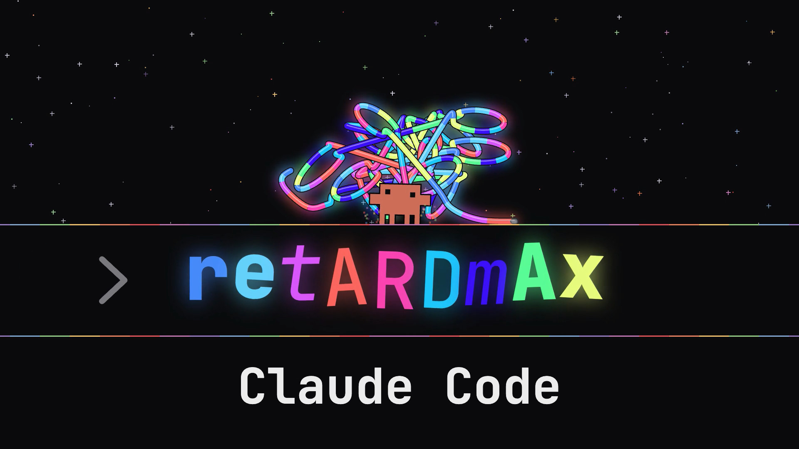
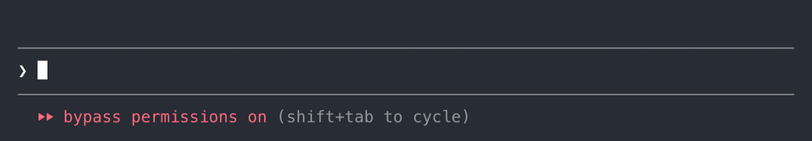

# retardmax



A Claude Code mod that works the opposite way to `ultrathink`. Put the word `retardmax` anywhere in a prompt and that turn runs at the **lowest reasoning effort** (`low`). Every subagent started during the turn also runs at `low`, for as long as it keeps running.



## Install

At the prompt of a Claude Code terminal session:

```
/plugin install retardmax --marketplace stablyai/claude-retardmax
```

Answer `y` to add the marketplace, then pick a scope. From a shell:

```
claude plugin install retardmax --marketplace stablyai/claude-retardmax
```

The repository is private: you need read access to it, and a git credential for github.com on your machine (`gh auth login` then `gh auth setup-git`).

## Develop

```
claude plugin validate .
claude plugin test .
claude --plugin-dir .
```
